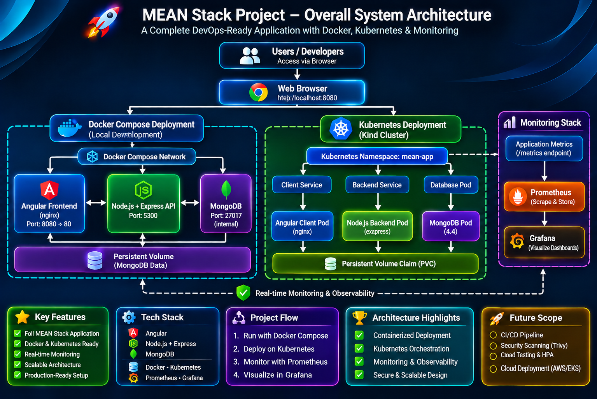
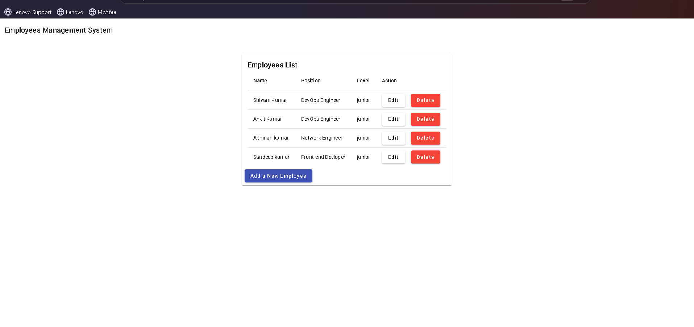
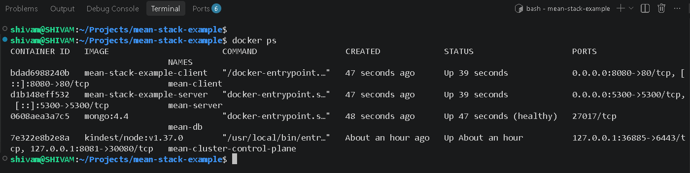
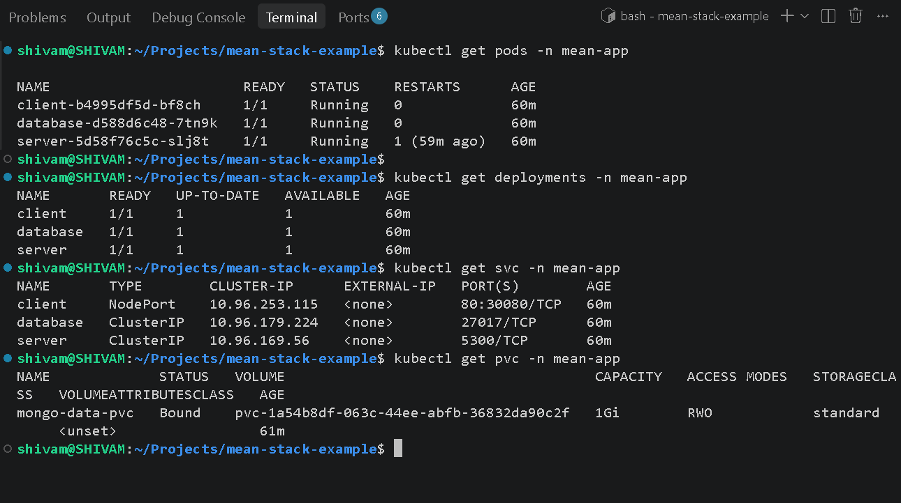
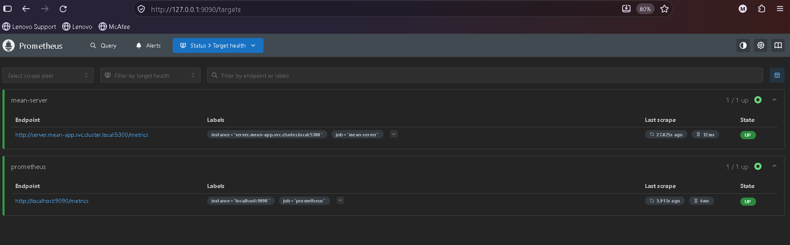
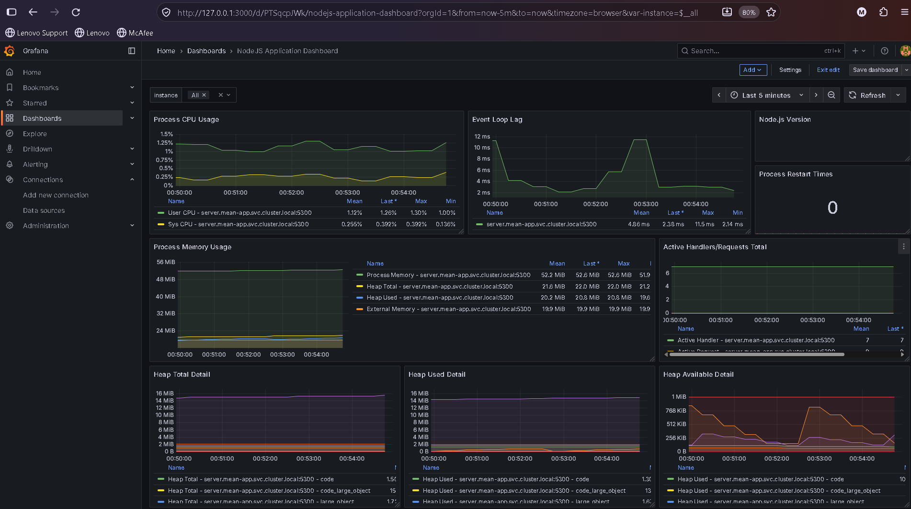
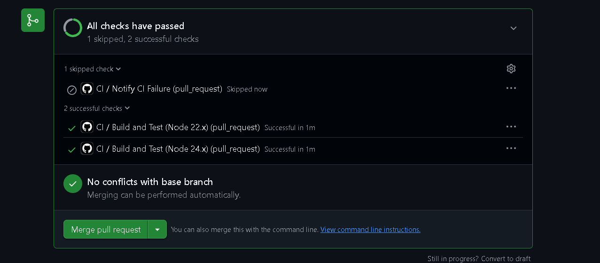
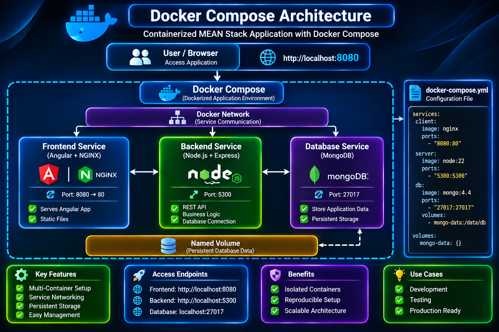
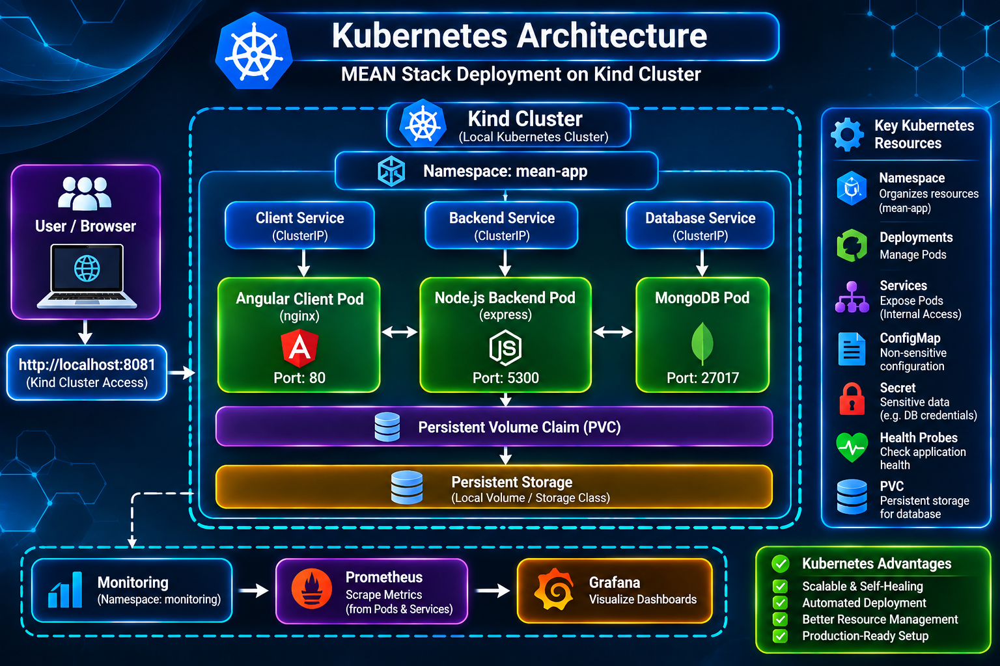
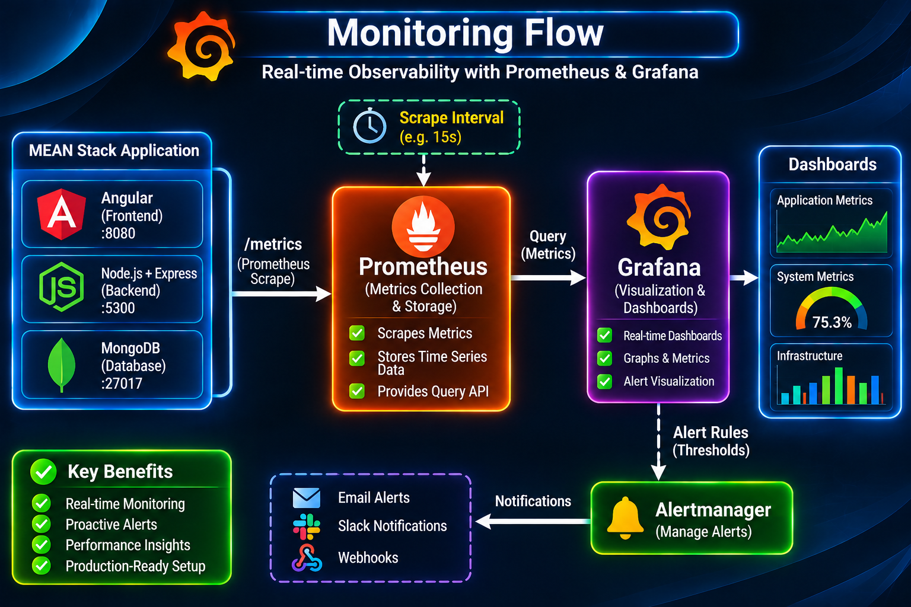

<div align="center">

# MEAN Stack Example — Employee Records Application


### A full-stack MEAN application with a hands-on DevOps deployment workflow

[](https://angular.dev/)
[](https://nodejs.org/)
[](https://expressjs.com/)
[](https://www.typescriptlang.org/)
[](https://www.mongodb.com/)
[](https://www.docker.com/)
[](https://docs.docker.com/compose/)
[](https://kubernetes.io/)
[](https://kind.sigs.k8s.io/)
[](https://github.com/features/actions)
[](https://prometheus.io/)
[](https://grafana.com/)
[](https://nginx.org/)

[Overview](#overview) • [Architecture](#architecture) • [Screenshots](#screenshots) • [Docker](#run-with-docker-compose) • [Kubernetes](#kubernetes-deployment-with-kind) • [Monitoring](#monitoring)

</div>

---

## Overview

This repository contains a full-stack **Employee Records Application** built with the **MEAN stack** — MongoDB, Express, Angular, and Node.js — and extended into a practical DevOps project.

The application supports employee record management through CRUD functionality (Create, Read, Update, and Delete). The project focuses on packaging, deploying, operating, and monitoring the application using container and Kubernetes tooling.

### Project highlights

- **Full-stack application:** Angular frontend with a Node.js, Express, and TypeScript REST API.
- **Containerization:** Separate frontend, backend, and database services using Docker.
- **Local orchestration:** Docker Compose for multi-container development and testing.
- **Kubernetes deployment:** Local Kubernetes deployment using Kind and manifests in `k8s/`.
- **Monitoring foundation:** Backend metrics exposed for Prometheus, with Prometheus and Grafana components included in the Kubernetes manifests.
- **Continuous Integration:** GitHub Actions workflow for builds, tests, health checks, and smoke tests.

> **Project scope:** The repository includes a GitHub Actions CI workflow. Docker Compose and Kubernetes are separate deployment options. An automated Continuous Deployment (CD) pipeline is not included.

## Contents

- [Overview](#overview)
- [Architecture](#architecture)
- [Technology Stack](#technology-stack)
- [Repository Structure](#repository-structure)
- [Screenshots](#screenshots)
- [Run with Docker Compose](#run-with-docker-compose)
- [Application Request Flow](#application-request-flow)
- [Kubernetes Deployment with Kind](#kubernetes-deployment-with-kind)
- [Monitoring](#monitoring)
- [API Endpoints](#api-endpoints)
- [Persistence](#persistence)
- [Security and Configuration Notes](#security-and-configuration-notes)
- [CI Workflow](#ci-workflow)
- [Useful Commands](#useful-commands)
- [Documentation](#documentation)
- [Known Limitations and Roadmap](#known-limitations-and-roadmap)
- [Attribution](#attribution)
- [Author](#author)

## Architecture

### Overall system architecture

The project supports two deployment paths:

1. **Docker Compose** — runs the frontend, backend, and MongoDB as separate containers.
2. **Kubernetes with Kind** — deploys the application to a local Kubernetes cluster using the supplied manifests.

The backend also exposes metrics for Prometheus monitoring.



### Architecture diagrams

| Diagram | Description |
|---|---|
| [Overall System Architecture](architecture/Overall-System-Architecture.png) | Application components, deployment options, and monitoring |
| [Application Request Flow](architecture/application-request-flow.png) | Browser requests through NGINX, Express, and MongoDB |
| [Docker Compose Architecture](architecture/docker-compose-architecture.png) | Compose services, networking, ports, and persistent volume |
| [Kubernetes Architecture](architecture/kubernetes-architecture.png) | Kind port mapping, Kubernetes Services, Pods, and database PVC |
| [Monitoring Flow](architecture/monitoring-flow.png) | Backend metrics, Prometheus scraping, and Grafana visualization |
| [Security & Configuration Architecture](architecture/security-configuration-architecture.png) | Configuration, Secret references, health checks, monitoring, and storage |

> Keep the diagram files at the paths shown above. If a diagram is not available in the repository yet, add it before publishing the corresponding image link. Mermaid source may be maintained in [`docs/architecture.md`](docs/architecture.md).

## Technology Stack

| Layer | Technology | Purpose |
|---|---|---|
| Frontend | Angular | Employee records user interface |
| Web server / reverse proxy | NGINX | Serves Angular assets and proxies `/api/` requests |
| Backend | Node.js, Express, TypeScript | REST API and application logic |
| Database | MongoDB | Employee record storage |
| Containers | Docker | Builds and runs application containers |
| Container orchestration | Docker Compose | Runs the application services together |
| Local Kubernetes | Kind, Kubernetes | Local cluster and application orchestration |
| Metrics | `prom-client`, Prometheus | Exposes and collects backend metrics |
| Dashboards | Grafana | Visualizes metrics when a data source and dashboard are configured |
| CI | GitHub Actions | Automates build, test, health-check, and smoke-test jobs |

## Repository Structure

```text
mean-stack-example/
├── .github/
│   └── workflows/
│       └── ci.yml
├── client/
│   ├── src/
│   ├── Dockerfile
│   └── nginx.conf
├── server/
│   ├── src/
│   ├── scripts/
│   ├── tests/
│   ├── Dockerfile
│   └── .env.example
├── docs/
│   ├── architecture.md
│   ├── deployment-guide.md
│   ├── troubleshooting.md
│   └── diagrams/
├── k8s/
│   ├── app/
│   ├── monitoring/
│   ├── kind-config.yaml
│   └── namespace.yaml
├── architecture/
│   └── ... architecture diagrams and banner
├── screenshots/
│   └── ... project screenshots
├── docker-compose.yml
├── README.md
├── LICENSE
└── NOTICE
```

This is a simplified view of the main files. The repository contains additional application and configuration files.

## Screenshots

Screenshots make it easier to understand the application and verify the project setup. Add your own screenshots to the `screenshots/` directory and use the filenames below, or update the paths to match your actual files.

### 1. Application interface

Show the employee records application running in the browser.



### 2. Docker Compose services

Show the frontend, backend, and database containers running.



### 3. Kubernetes deployment

Show the application Pods, Services, and PersistentVolumeClaims.



### 4. Prometheus targets

Show the backend scrape target and its health status in Prometheus.



### 5. Grafana dashboard

Add a screenshot after configuring the Prometheus data source and confirming that the dashboard displays real metrics.



### 6. GitHub Actions CI

Show a successful run of the repository's CI workflow.



> **Screenshot note:** These are image paths/placeholders for the repository. Add the corresponding image files before expecting them to render on GitHub. Do not present a dashboard or workflow as successful until you have verified it.

## Run with Docker Compose

### Docker Compose architecture

The Docker Compose deployment runs the Angular frontend, Node.js/Express backend, and MongoDB database as separate services.



### Prerequisites

- Docker Engine
- Docker Compose plugin

Verify the installation:

```bash
docker --version
docker compose version
```

A local Node.js or MongoDB installation is not required for the containerized deployment.

### 1. Validate the configuration

Run from the repository root:

```bash
docker compose config
```

### 2. Build and start the services

```bash
docker compose up --build -d
```

Check service status:

```bash
docker compose ps
```

### 3. Open the application

Visit **http://localhost:8080** in your browser.

### Docker Compose services

| Service | Container | Port / access | Role |
|---|---|---|---|
| `client` | `mean-client` | Host `8080` → container `80` | Angular frontend served by NGINX |
| `server` | `mean-server` | Host `5300` → container `5300` | Express API |
| `database` | `mean-db` | Internal port `27017` | MongoDB database |

MongoDB is **not published to a host port** in the supplied Compose configuration. The backend reaches it through Compose service discovery:

```text
mongodb://database:27017/
```

### Docker Compose request path

1. The browser loads the Angular application from `http://localhost:8080`.
2. NGINX serves the static frontend files.
3. Requests sent to `/api/` are reverse-proxied to the `server` service on port `5300`.
4. NGINX removes the `/api/` prefix because the `proxy_pass` target ends with `/`.
5. Express handles the request and reads or updates employee records in MongoDB.
6. The API response returns through NGINX to the browser.

For example, `/api/employees` is proxied to `/employees`, matching the backend router mount.

## Application Request Flow

The normal request/response path is:

**Browser → NGINX → Express API → MongoDB → Express API → NGINX → Browser**


The exact API methods and request payloads are defined in the application source. See the route file and frontend service code before relying on this README as a complete API contract.

## Kubernetes Deployment with Kind

The repository includes Kubernetes manifests under `k8s/` and a Kind configuration that maps host address `127.0.0.1:8081` to node port `30080`.

- The client Service uses NodePort `30080`.
- The backend and database use internal Kubernetes Services.
- The backend manifest references a Secret named `mean-mongo-credentials` with the key `DATABASE_URI`.

> **Important:** The database Deployment uses `mongo:4.4` with authentication enabled. Before deploying to a fresh cluster, verify that MongoDB is initialized with credentials consistent with the backend's `DATABASE_URI`. Creating a Kubernetes Secret does not itself create a MongoDB user.

### Kubernetes architecture



### Deployment overview

The typical workflow is:

1. Create a Kind cluster using `k8s/kind-config.yaml`.
2. Build the client and server images.
3. Load those images into the Kind cluster.
4. Create the required Kubernetes Secret locally.
5. Apply the namespace, application, and monitoring manifests.
6. Verify Pods, Services, PVCs, logs, and the Prometheus target.
7. Open the application at **http://127.0.0.1:8081**.

Follow [`docs/deployment-guide.md`](docs/deployment-guide.md) for the detailed command sequence. Confirm the actual filenames and resource names before running commands; adapt the cluster name to your environment.

## Monitoring

The backend exposes two operational endpoints:

| Endpoint | Purpose |
|---|---|
| `GET /healthcheck` | Returns a JSON health status |
| `GET /metrics` | Exposes Prometheus-format metrics collected by `prom-client` |

The supplied Prometheus configuration scrapes the backend at:

```text
server.mean-app.svc.cluster.local:5300/metrics
```

The Kubernetes manifests include Prometheus and Grafana. Prometheus is configured with short retention and does not have a PVC defined in the supplied manifest. A Grafana PVC manifest is included.

### Monitoring flow



**Verification before claiming a working dashboard:** check that the Prometheus target is `UP`, confirm Grafana's Prometheus data source is configured, and verify the dashboard displays real metrics. The presence of deployment manifests alone does not prove that a data source or dashboard has been provisioned.

## API Endpoints

| Method | Endpoint | Purpose |
|---|---|---|
| `GET` | `/healthcheck` | Backend health status |
| `GET` | `/metrics` | Prometheus metrics |
| `GET` | `/employees` | Employee collection route |
| Other CRUD methods | `/employees` and `/employees/:id` | See the backend route implementation for exact supported methods and behavior |

The frontend uses the `/api/` prefix through NGINX. The proxy removes that prefix before forwarding to Express.

For the precise API contract, inspect `server/src/employee.routes.ts` and the frontend's API service before documenting individual request bodies or status codes.

## Persistence

### Docker Compose

MongoDB data is stored in the named volume:

```text
mongo-data → /data/db
```

Stopping the Compose stack normally keeps the named volume:

```bash
docker compose down
docker compose up -d
```

To delete the Compose-managed volume and its stored data:

```bash
docker compose down -v
```

> **Warning:** `docker compose down -v` is destructive for the database volume. Use it only when you intentionally want to remove local database data.

### Kubernetes

The MongoDB Deployment references a PersistentVolumeClaim named `mongo-data-pvc`. Check that the PVC is `Bound` before relying on persistent database storage.

## Security and Configuration Notes

- Do not commit passwords, tokens, full connection strings, or real Secret values.
- Base64-encoded Kubernetes Secret data is **not encryption**. Treat it as sensitive.
- The backend Kubernetes manifest references `mean-mongo-credentials` and the key `DATABASE_URI`; create and manage the value locally.
- Review backup files and old deployment backups before publishing. Remove any artifact containing credentials or private data.
- MongoDB uses `mongo:4.4` in the supplied Compose and Kubernetes manifests. This is an old release line; plan a compatible, tested upgrade rather than changing the image tag without migration testing.
- Docker Compose networking and Kubernetes Services provide service-to-service connectivity. Kubernetes NetworkPolicies, firewall rules, HTTPS/TLS, Trivy image scanning, and application RBAC should not be described as implemented unless they are added and verified.
- The security/configuration diagram documents the repository's configuration references and operational components; it is not a claim that the application is production-hardened.

### Security & Configuration Architecture


## CI Workflow

The repository includes `.github/workflows/ci.yml`.

The workflow runs on pushes to `main`, pull requests, manual dispatch, and a scheduled trigger. Its jobs include:

- Dependency installation
- Application build
- Server tests
- Integration tests
- Seeding demo data
- Starting the API
- Checking `/healthcheck`
- Smoke-testing `/employees`

This is **Continuous Integration (CI)**. The supplied workflow does **not** deploy the application to Kubernetes or a cloud environment, so automated Continuous Deployment (CD) is not included.

## Useful Commands

### Docker Compose

```bash
# Show the resolved Compose configuration
docker compose config

# Start / rebuild the stack
docker compose up --build -d

# Check services
docker compose ps

# Follow all logs
docker compose logs -f

# Follow backend logs
docker compose logs -f server

# Stop containers but preserve named volumes
docker compose down
```

### Kubernetes

```bash
# Inspect application resources
kubectl get pods -n mean-app
kubectl get services -n mean-app
kubectl get pvc -n mean-app

# Inspect monitoring resources
kubectl get pods -n monitoring
kubectl get services -n monitoring

# Check backend logs
kubectl logs -n mean-app deployment/server
```

These commands assume the resource names and namespaces match the manifests in your checkout.

## Documentation

- [Architecture and Mermaid diagrams](docs/architecture.md)
- [Deployment Guide](docs/deployment-guide.md)
- [Troubleshooting Guide](docs/troubleshooting.md)

## Known Limitations and Roadmap

These are potential improvements, not claims that the capabilities are already implemented:

- [ ] Add and verify actual application and Grafana dashboard screenshots.
- [ ] Test the complete Docker Compose and Kind deployment from a clean environment.
- [ ] Confirm MongoDB authentication initialization and connection-string behavior.
- [ ] Configure and verify a Grafana data source and dashboard.
- [ ] Consider persistent storage and retention planning for Prometheus.
- [ ] Plan a tested migration from the old MongoDB image.
- [ ] Add image vulnerability scanning and document the results.
- [ ] Consider NetworkPolicies, HTTPS/TLS, and access-control hardening where appropriate.
- [ ] Add a CD deployment workflow only after deciding on a target environment and safe release process.

## Attribution

This repository is based on the upstream MEAN Stack Example. Preserve the included `LICENSE` and `NOTICE` files and follow their terms when modifying or redistributing the project.

---

## Author

<div align="center">

### Shivam Kumar Sinha

**DevOps | Cloud Computing | Linux | Networking | Docker | Kubernetes**

[](https://github.com/Shivam-Infra-Labs)
[](https://www.linkedin.com/in/shivam-kumar-sinha-0a9248308/)

</div>

---

## Support

If you find this project helpful, consider giving the repository a ⭐ on GitHub.

<div align="center">

Made with ❤️ by **Shivam Kumar Sinha**

</div>
