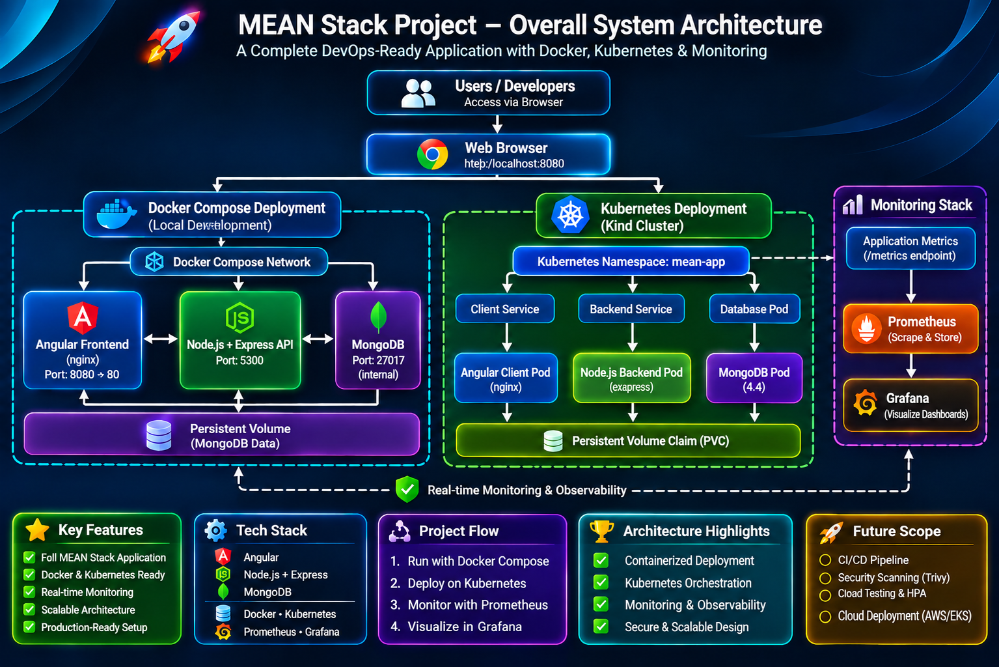
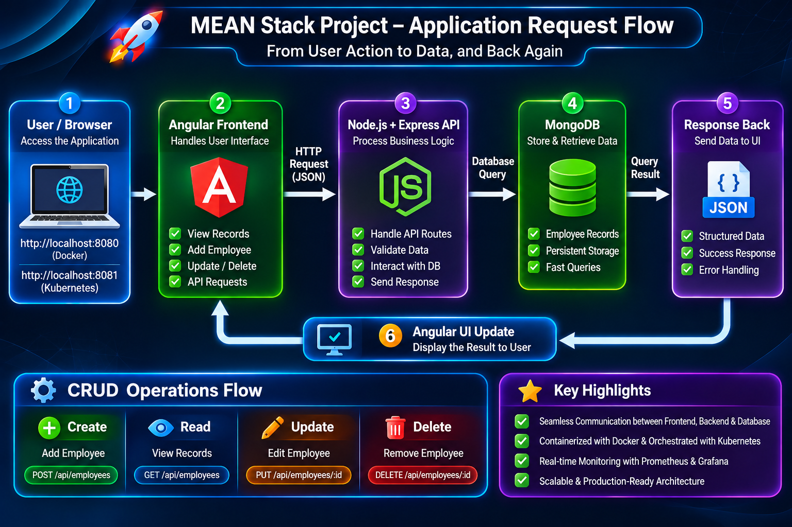
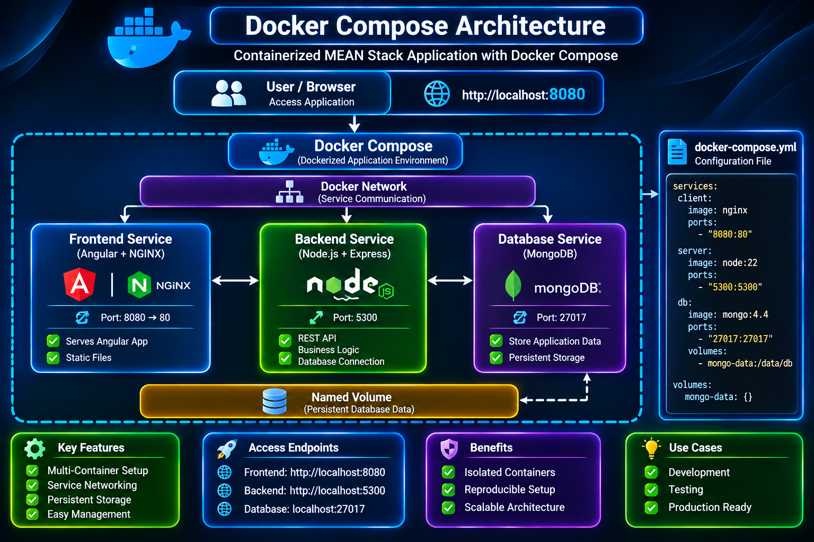
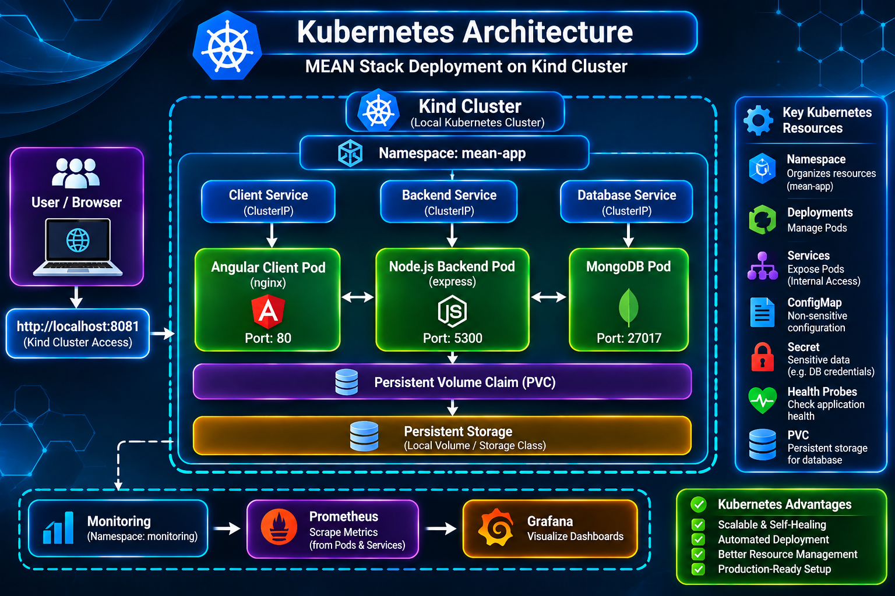
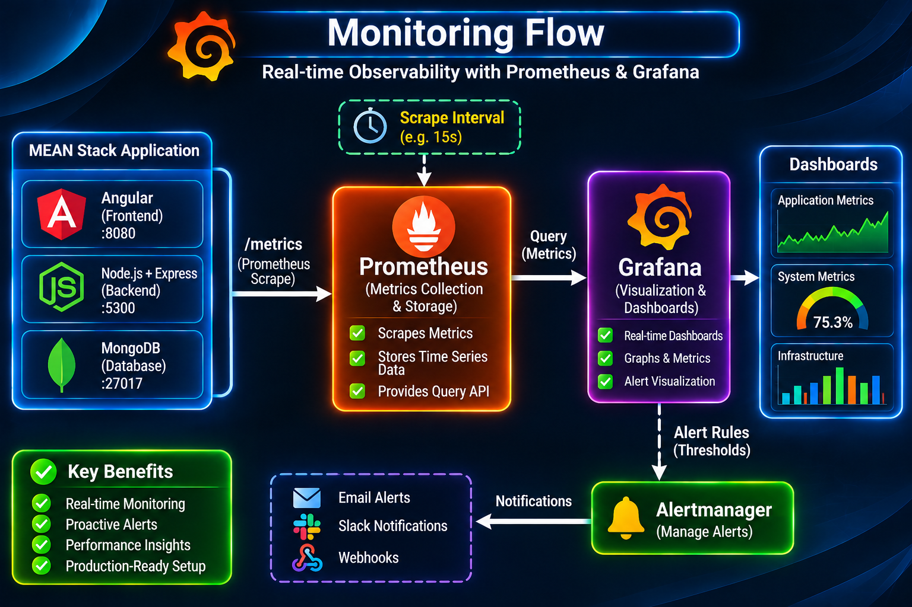

# MEAN Stack Architecture

## 1. Overview

This document describes the architecture of the Employee Records application and its DevOps deployment environment.

The application uses the MEAN stack:

- **MongoDB:** NoSQL database.
- **Express.js:** Backend web framework.
- **Angular:** Frontend framework.
- **Node.js:** Backend JavaScript runtime.

The project demonstrates how a multi-tier web application can be containerized, run locally with Docker Compose, deployed to Kubernetes using Kind, and monitored with Prometheus and Grafana.

## 2. High-Level Architecture

The application has three primary runtime components:

1. Angular frontend.
2. Node.js and Express backend.
3. MongoDB database.

```text
                  User / Browser
                        |
                        v
                 Angular Frontend
                        |
                   HTTP / API
                        |
                        v
                Node.js / Express
                        |
                 Database Queries
                        |
                        v
                     MongoDB
```

The frontend handles the user interface, the backend implements application logic and API routes, and MongoDB stores employee records.

## 3. Overall System Architecture



The system has two main application deployment options:

- Docker Compose for local containerized execution.
- Kubernetes on Kind for local orchestration.

The monitoring stack is deployed separately in the `monitoring` namespace.

## 4. Application Request Flow



The normal request-response lifecycle is:

1. A user opens the application in a browser.
2. Angular renders the user interface.
3. Angular sends an API request.
4. NGINX forwards the request to the Express backend.
5. Express processes the request and interacts with MongoDB.
6. The backend returns a response.
7. Angular updates the interface.

### NGINX API Proxy

The frontend NGINX configuration includes:

```nginx
location /api/ {
    proxy_pass http://server:5300/;
}
```

The trailing slash in `proxy_pass` means the matching `/api/` location prefix is replaced when forwarding the request.

For example:

```text
Browser request:
  /api/employees

Backend request:
  /employees
```

This is why the backend API routes can use `/employees` while the frontend calls `/api/employees`.

## 5. Docker Architecture



The project builds separate images for the frontend and backend. MongoDB uses the configured MongoDB image.

### 5.1 Docker Compose Services

| Service | Image/build | Internal port | Host port |
|---|---|---:|---:|
| `client` | `./client` Dockerfile | 80 | 8080 |
| `server` | `./server` Dockerfile | 5300 | 5300 |
| `database` | `mongo:4.4` | 27017 | Not published |

The backend waits for the database health check before starting through the Compose dependency condition.

### 5.2 Service Communication

Compose services communicate over the internal Docker network using service DNS names.

The backend connects to MongoDB through:

```text
mongodb://database:27017/
```

The database hostname is `database`, not `localhost`. Inside a container, `localhost` refers to that same container.

### 5.3 Persistent Storage

The Compose file declares a named volume:

```yaml
volumes:
  mongo-data:
```

The database mounts it at:

```text
/data/db
```

This allows MongoDB data to persist when the database container is replaced, as long as the named volume is retained.

### 5.4 Compose Security Scope

The current Compose configuration does not enable MongoDB authentication and does not publish MongoDB's port to the host.

Use this configuration for controlled local development. Do not treat it as a production database security configuration.

## 6. Kubernetes Architecture



The local Kubernetes environment uses Kind.

### 6.1 Cluster Configuration

The Kind configuration creates a control-plane node and maps:

| Kind node port | Host port | Bind address |
|---:|---:|---|
| 30080 | 8081 | 127.0.0.1 |

This makes the frontend available at:

```text
http://127.0.0.1:8081
```

### 6.2 Namespace

The application resources are deployed into:

```text
mean-app
```

The monitoring resources are deployed into:

```text
monitoring
```

Namespaces provide logical separation of resources within the cluster.

### 6.3 Deployments and Services

| Component | Deployment | Service | Service type |
|---|---|---|---|
| Frontend | `client` | `client` | NodePort |
| Backend | `server` | `server` | ClusterIP |
| MongoDB | `database` | `database` | ClusterIP |

The frontend Service exposes port 80 and maps it to NodePort 30080.

The backend Service exposes port 5300 internally.

The database Service exposes port 27017 internally.

### 6.4 ConfigMap

The project uses `mean-server-config` for non-sensitive backend configuration.

The current ConfigMap provides the backend port:

```yaml
data:
  PORT: "5300"
```

ConfigMaps should not contain passwords, tokens or other sensitive values.

### 6.5 Secret

The Kubernetes manifests reference a Secret named:

```text
mean-mongo-credentials
```

The database Deployment expects these keys:

- `MONGO_INITDB_ROOT_USERNAME`
- `MONGO_INITDB_ROOT_PASSWORD`

The backend Deployment expects:

- `DATABASE_URI`

The database URI must use the same credentials as the MongoDB initialization configuration and include `authSource=admin`.

A Secret resource does not itself create a MongoDB user. The official MongoDB container's initialization behavior creates the root user when initializing a new data directory with the appropriate environment variables. Existing database data and an already initialized PVC require separate consideration.

### 6.6 Persistent Storage

The MongoDB Deployment uses the claim:

```text
mongo-data-pvc
```

The claim requests:

- Storage: 1 GiB.
- Access mode: ReadWriteOnce.

The claim is mounted into MongoDB at `/data/db`.

A PVC provides persistent storage according to the cluster's storage provisioner. It is not a backup system.

### 6.7 Health Probes

The backend Deployment defines:

- Startup probe.
- Readiness probe.
- Liveness probe.

All use:

```text
/healthcheck
```

The frontend Deployment uses HTTP probes against `/`.

A successful health endpoint response confirms that the endpoint responds; it does not automatically guarantee that every dependency remains healthy after startup.

## 7. Monitoring Architecture



The monitoring configuration includes Prometheus and Grafana resources.

### 7.1 Prometheus

Prometheus collects metrics from configured targets.

The intended backend target is:

```text
server.mean-app.svc.cluster.local:5300/metrics
```

The backend must expose valid Prometheus-format metrics, and Prometheus must be able to reach the target.

### 7.2 Grafana

Grafana visualizes metrics queried from a Prometheus data source.

The actual availability of dashboards and data depends on the Grafana provisioning, data-source configuration and dashboard files included in the monitoring manifests.

### 7.3 Access

The monitoring Services are accessed locally using port forwarding:

```bash
kubectl port-forward svc/prometheus 9090:9090 -n monitoring
```

```bash
kubectl port-forward svc/grafana 3000:3000 -n monitoring
```

## 8. Security and Configuration Architecture


The project separates configuration into different resource types:

| Resource | Intended use |
|---|---|
| Docker Compose environment | Local container configuration |
| Kubernetes ConfigMap | Non-sensitive configuration |
| Kubernetes Secret | Credentials and sensitive values |
| PVC | Persistent database data |
| Kubernetes probes | Application health checks |

Security considerations:

- Do not commit credentials to source control.
- Restrict access to Kubernetes Secrets.
- Use strong, unique database passwords.
- Review RBAC permissions.
- Do not expose the database publicly without a deliberate design.
- Use maintained container images.
- Configure TLS for untrusted network paths.
- Implement and test backups.
- Review resource limits, network policies and image vulnerabilities.

The diagram is an architectural overview. It does not imply that every recommended security control, notification system or production hardening feature is already deployed.

## 9. Current Project Scope

Implemented configuration represented in this repository includes:

- Dockerfiles for frontend and backend.
- Docker Compose services and named database volume.
- Kind cluster configuration.
- Kubernetes application manifests.
- ConfigMap and Secret references.
- MongoDB PersistentVolumeClaim.
- Frontend and backend health probes.
- Prometheus and Grafana manifests.
- GitHub Actions CI workflow.

The following should be treated as future improvements until separately implemented and tested:

- Production-grade TLS and ingress.
- Automated backups and restore testing.
- NetworkPolicies and hardened RBAC.
- Image vulnerability scanning.
- Autoscaling.
- GitOps deployment.
- Cloud deployment.

## 10. Conclusion

This architecture provides a practical learning environment for understanding the path from a full-stack application to containerized services, Kubernetes orchestration, persistent storage and monitoring.

The architecture document should be updated whenever the application code, Docker configuration, Kubernetes manifests or monitoring implementation changes.